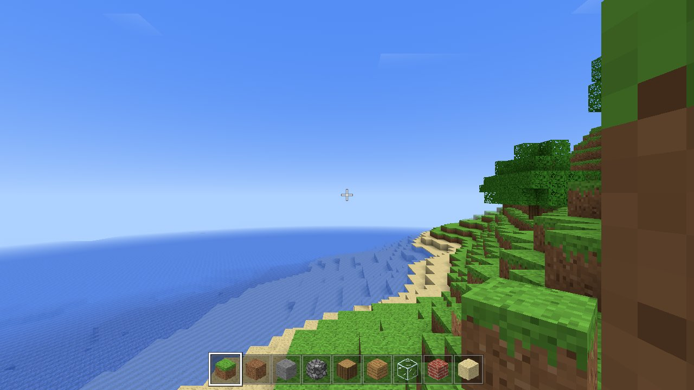
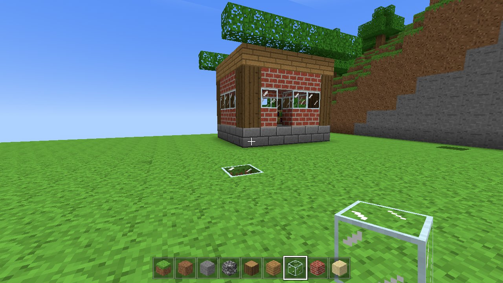
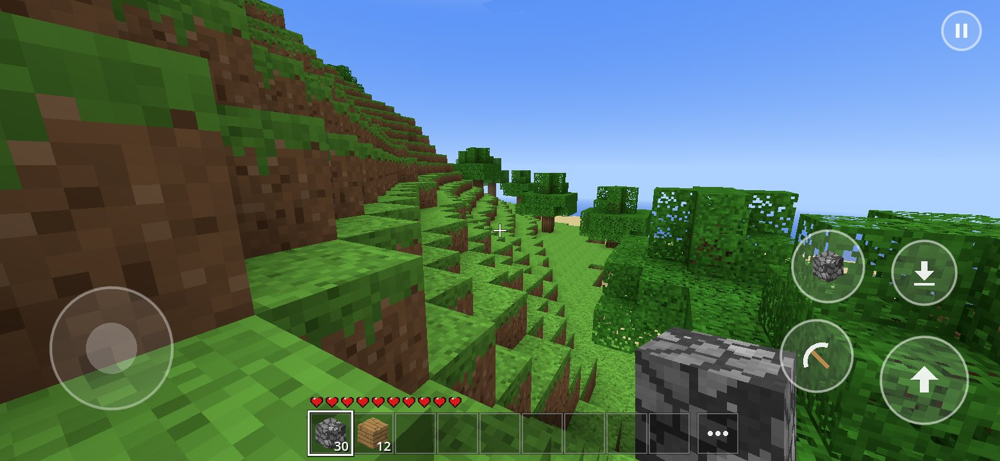
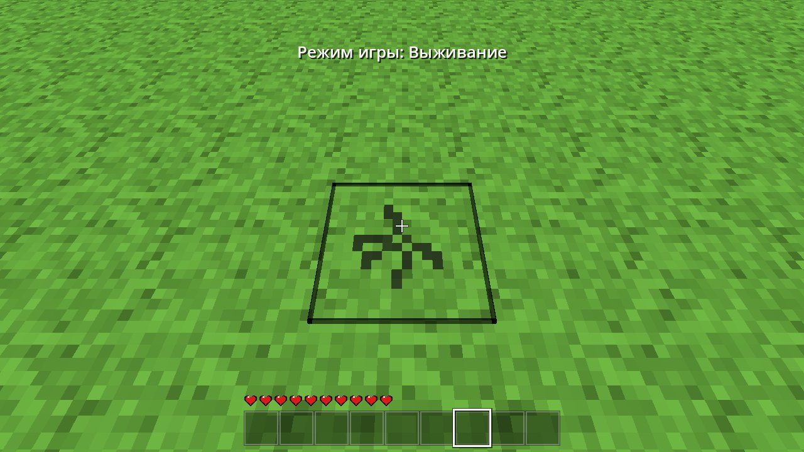
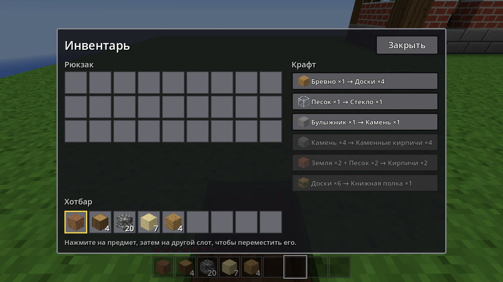
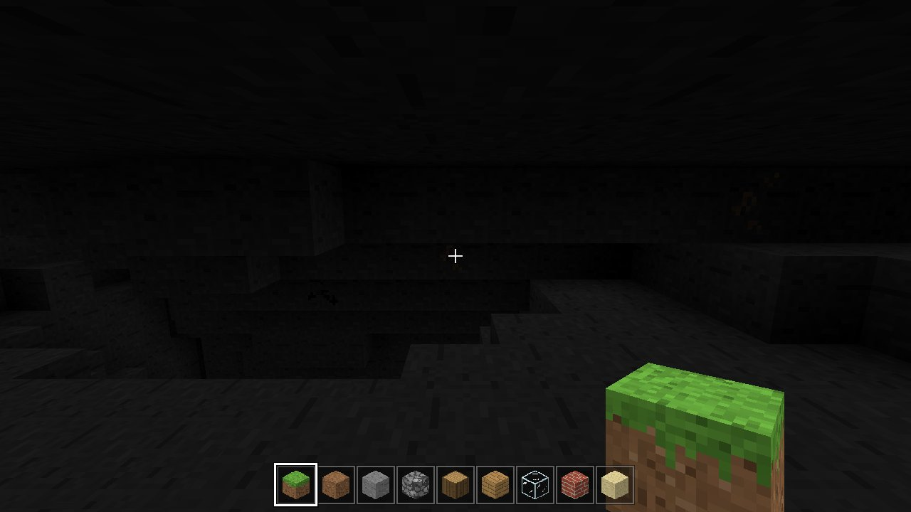

# BlockCraft — Minecraft-подобная песочница на Godot 4

Воксельная игра в стиле Minecraft, написанная на GDScript для **Godot 4.3+** (рендерер
*Compatibility* — работает на слабых телефонах, планшетах и в браузере). Никаких внешних
ассетов: текстуры 16×16, иконки блоков, облака и небо генерируются кодом при запуске.

| | |
|---|---|
|  |  |
|  |  |
|  |  |

Скриншоты сделаны автотестом (`tests/visual_test.gd`) с программным рендерингом; остальные —
в папке [`docs/screenshots`](docs/screenshots).

## Возможности

- **Бесконечный мир** из чанков 16×128×16: равнины, холмы, горы со снежными вершинами,
  моря и пляжи, леса, пещеры, угольная и железная руда, коренная порода.
- **Копание и строительство**: 18 типов блоков (трава, земля, камень, булыжник, брёвна,
  листва, доски, песок, стекло, кирпичи, снег, гравий, книжные полки и др.), рамка выделения,
  трещины при добыче, вода затекает в выкопанные рядом с ней ямы.
- **Режим креатива**: бесконечные блоки, мгновенное разрушение, полёт (двойной прыжок),
  палитра всех блоков, нет урона.
- **Режим выживания**: 10 сердец, урон от падения, регенерация, добыча блоков со временем,
  выпадающие предметы, инвентарь на 36 слотов, простой крафт (доски, стекло, камень,
  каменные кирпичи, кирпичи, книжные полки), смерть с выпадением вещей и возрождение.
- **Сохранение всего мира**: изменённые чанки пишутся на диск (сжатие zstd) при выгрузке —
  когда вы уходите далеко, — а также автоматически каждые 15 секунд, при паузе, сворачивании
  приложения и выходе. Сохраняются позиция, взгляд, здоровье, инвентарь, режим, время суток
  и лежащие на земле предметы. Несколько миров, выбор сида.
- **Мобильная адаптация**: сенсорное управление с мультитачем, автоматическое включение на
  телефонах/планшетах, учёт выреза экрана, автопрыжок, крупный интерфейс, альбомная ориентация,
  кнопка «Назад» на Android.
- Смена дня и ночи, закаты, облака, туман по дальности, ambient occlusion и затенение в пещерах,
  блок в руке с анимацией, плавание и подводный туман.
- Генерация и построение мешей чанков в фоновых потоках (`WorkerThreadPool`), поэтому игра
  не подтормаживает при подгрузке мира.

## Управление

### Клавиатура и мышь

| Действие | Клавиша |
|---|---|
| Ходьба | `W` `A` `S` `D` (или стрелки; работают в любой раскладке) |
| Прыжок / подъём в полёте | `Пробел` |
| Полёт (только креатив) | двойное нажатие `Пробел` |
| Присесть / спуск в полёте | `Shift` |
| Бег | `Ctrl` или двойное нажатие `W` |
| Сломать блок | левая кнопка мыши (в выживании — удерживать) |
| Поставить блок | правая кнопка мыши |
| Взять блок в руку | средняя кнопка мыши |
| Выбор слота | `1`–`9`, колесо мыши |
| Инвентарь | `E` |
| Выбросить предмет | `Q` |
| Пауза / меню | `Esc` |
| Сменить режим (креатив ↔ выживание) | `F4` или кнопка в меню паузы |
| FPS и координаты | `F3` |

### Сенсорный экран

- **Левая часть экрана** — джойстик (появляется под пальцем). Толкните до упора вперёд — бег.
- **Правая часть** — поворот камеры свайпом. **Короткий тап** — поставить блок,
  **удержание** — ломать блок под прицелом.
- Кнопки справа: прыжок (двойной тап в креативе — полёт), присесть/спуск, кирка (ломать),
  блок (поставить), «ПОЛЁТ» (в креативе), пауза в правом верхнем углу.
- Тап по хотбару выбирает слот, кнопка «•••» открывает инвентарь.

Сенсорное управление включается автоматически на устройствах с сенсорным экраном; в
настройках его можно принудительно включить или выключить.

## Запуск

1. Установите [Godot 4.3](https://godotengine.org/download) или новее (обычная версия, не .NET).
2. Откройте папку проекта в Godot (Import → `project.godot`) и нажмите F5.

Из командной строки: `godot --path .`

### Сборка для телефона

В `export_presets.cfg` уже есть пресеты **Android** и **Web**. Установите шаблоны экспорта
(Editor → Manage Export Templates) и выполните *Project → Export*. Для Android также нужны
Android SDK и keystore (см. документацию Godot «Exporting for Android»). Web-сборка
работает в мобильных браузерах; для неё подходит однопоточный режим — мир тогда
генерируется в основном потоке маленькими порциями.

## Тесты

```bash
# Юнит-тесты логики (генерация, меши, инвентарь, сохранения, физика игрока):
godot --headless --path . -s res://tests/unit_tests.gd

# Визуальный сценарий: создаёт мир, копает, строит, переключает режимы, эмулирует
# касания, сохраняет/загружает мир и делает скриншоты (нужен экран или Xvfb):
godot --path . --rendering-driver opengl3 -- --visual-test --shots=/абсолютный/путь

# Проверка вёрстки и касаний при другом разрешении (телефон, планшет):
godot --path . --rendering-driver opengl3 --resolution 1560x720 -- --visual-test --layout-test --shots=/путь
```

## Структура проекта

```
project.godot              настройки проекта (рендерер Compatibility, растяжение UI, ориентация)
scenes/                    main_menu.tscn, game.tscn — корневые сцены (интерфейс строится в коде)
scripts/globals/game.gd    автозагрузка: настройки, раскладка клавиш, переходы, создание миров
scripts/game_scene.gd      игровая сцена: мир + игрок + UI, день/ночь, предметы, автосохранение
scripts/world/
  blocks.gd                реестр блоков (свойства, текстуры граней, прочность, дроп)
  world_gen.gd             генерация ландшафта, пещер, руды и деревьев по сиду
  chunk_mesher.gd          меш чанка: отсечение граней, AO, освещение, вода
  chunk.gd, chunk_job.gd   данные чанка и фоновые задачи генерации/мешинга
  world.gd                 подгрузка чанков, правка блоков, рейкаст, сохранение
  world_storage.gd         файлы мира: meta.json и сжатые чанки
  texture_factory.gd       процедурные текстуры, иконки, шейдеры
scripts/player/            игрок (физика, взаимодействие) и инвентарь
scripts/entities/          выпавшие предметы
scripts/ui/                HUD, сенсорное управление, инвентарь, меню, настройки, тема
tests/                     юнит-тесты и визуальный автотест
```

Сохранения лежат в `user://worlds/<id>/` (на Windows — `%APPDATA%\Godot\app_userdata\BlockCraft`,
на Linux — `~/.local/share/godot/app_userdata/BlockCraft`, на Android — во внутренней памяти приложения).
