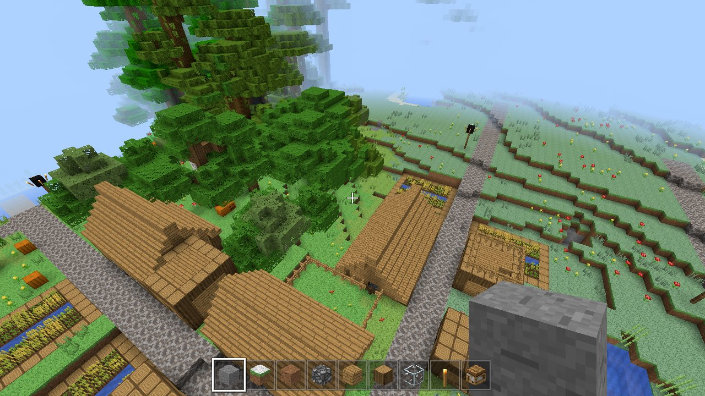
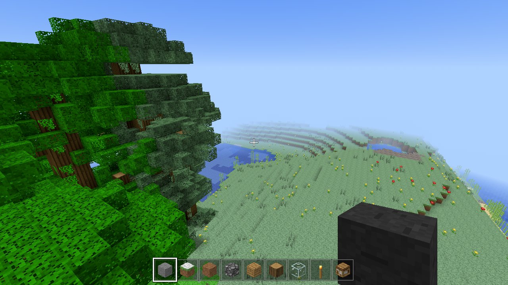
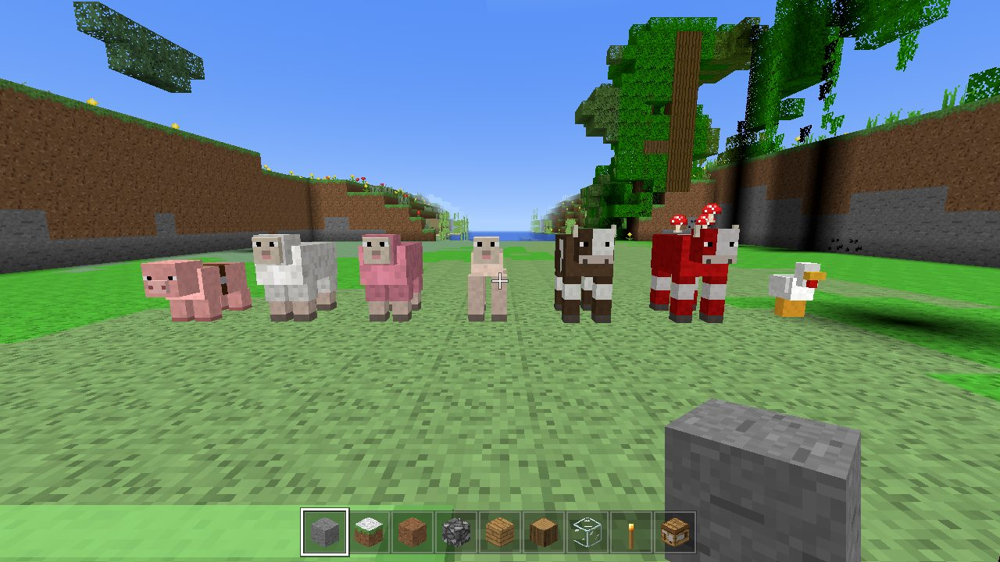
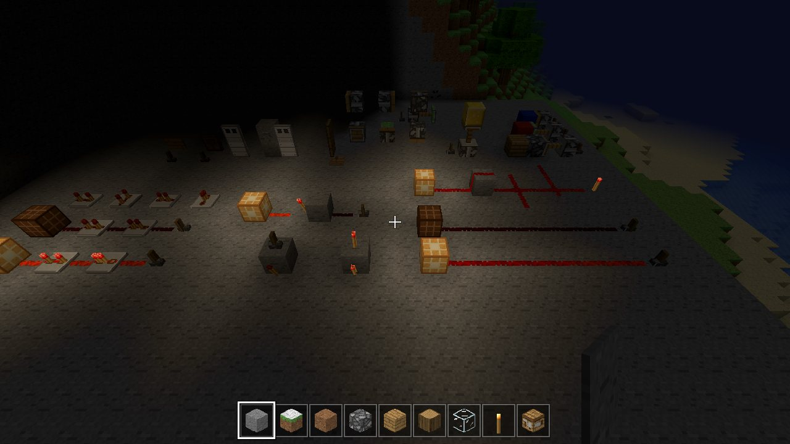
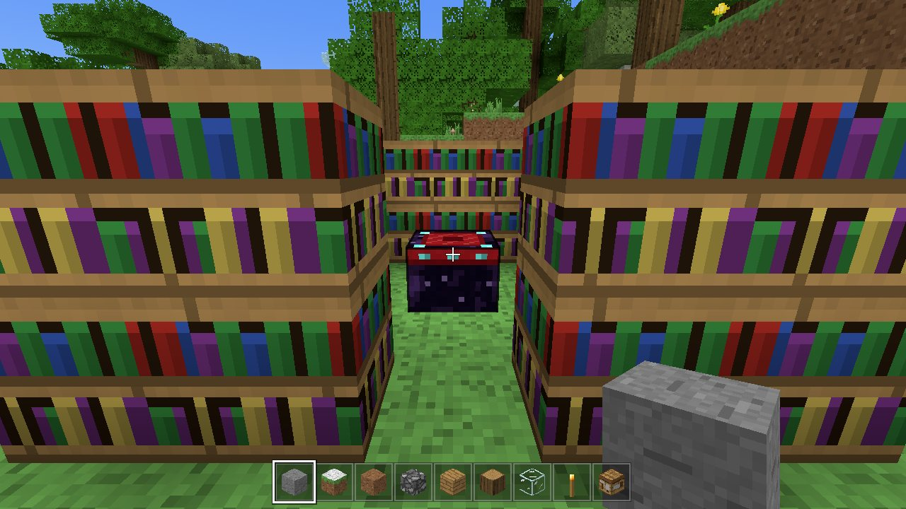
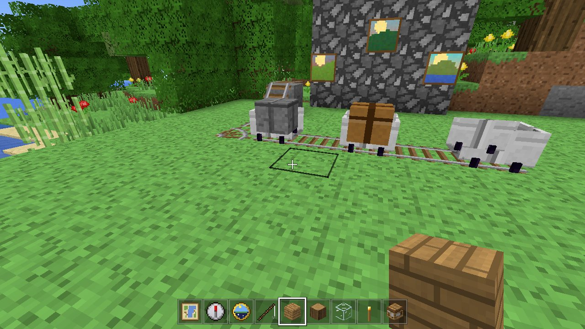
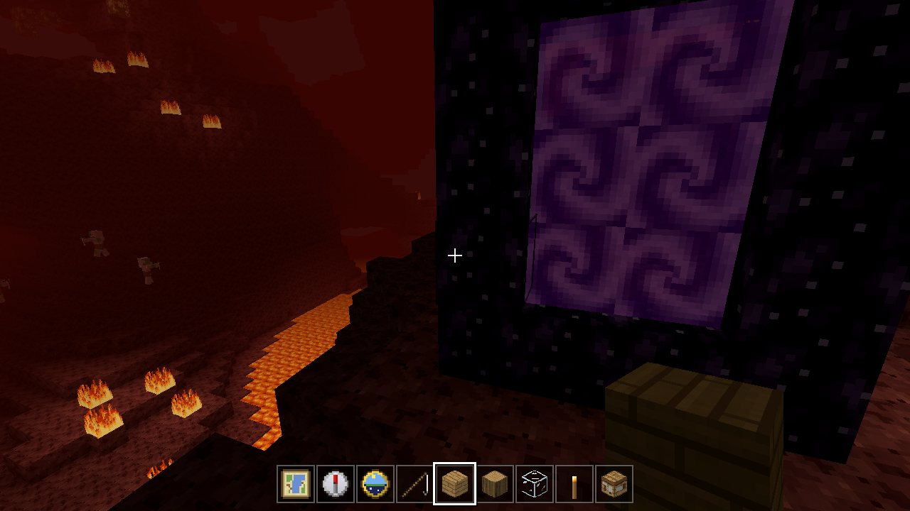
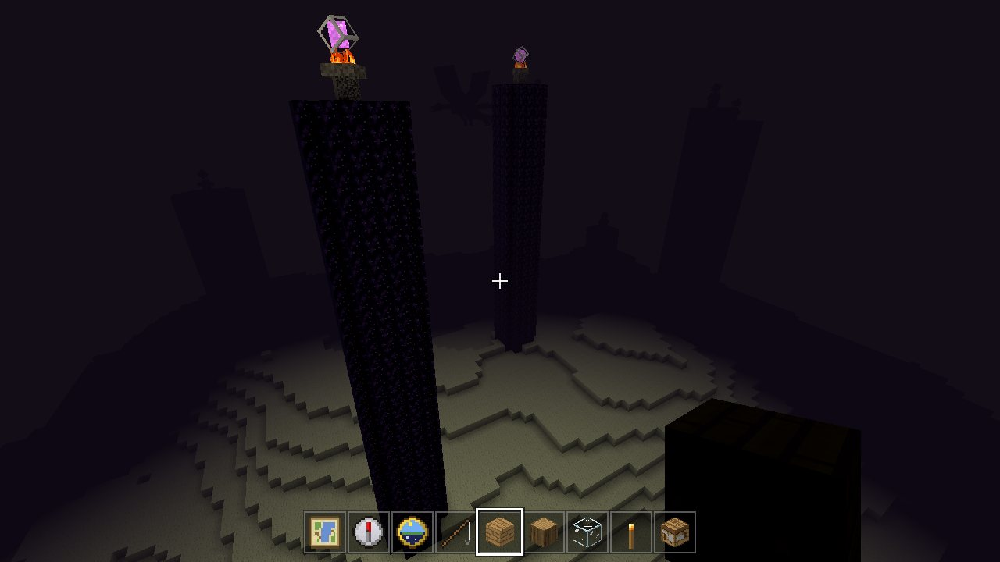

# BlockCraft — песочница в духе Minecraft 1.2 на Godot 4

Воксельная игра на GDScript для **Godot 4.3+** (рендерер *Compatibility* — работает на слабых
телефонах, планшетах и в браузере) с функционалом **Minecraft Java Edition 1.2**. Никаких внешних
ассетов: текстуры, иконки, модели существ, картины и звуки генерируются кодом при запуске.

| | |
|---|---|
|  |  |
|  |  |
|  |  |
|  |  |

Скриншоты сделаны автотестами с программным рендерингом; остальные — в папке
[`docs/screenshots`](docs/screenshots).

## Возможности (Minecraft 1.2)

### Мир
- **Высота мира 256 блоков** (появилась в 1.2), чанки 16×256×16, бесконечный мир по сиду.
- **23 биома 1.2**, включая новые **джунгли** с огромными деревьями, лианами и оцелотами; цвет травы
  и листвы зависит от биома; реки, пляжи, грибные острова, горы, тайга, болота, пустыни, снега.
- Пещеры и ущелья, руды на своих высотах, озёра воды и лавы, **родники** в стенах пещер,
  данжи с рассадниками и сундуками, **пустынные колодцы** (1.2).
- Постройки: **деревни** с жителями и железными големами, **заброшенные шахты**, **крепости**
  с порталом в Край, **адские крепости** с ифритами и адским наростом.
- Настройки нового мира, как в 1.2: режим (выживание, креатив, **хардкор**), сложность,
  **тип мира — обычный или суперплоский**, **генерация построек** вкл/выкл, сид.
- **Нижний мир** (порталы из обсидиана, лавовое море, лавопады, песок душ, светокамень, огонь,
  гасты, зомби-свинолюди, магмовые кубы) и **Край** (остров, обсидиановые столбы с кристаллами,
  **дракон Края**, портал выхода и яйцо дракона).

### Блоки и предметы
- Все **125 блоков 1.2** (номера 0–124) и все предметы 256–385, включая пластинки, **огненный
  заряд** и **пузырёк опыта** (новые в 1.2); **лампа из красного камня** (1.2) и разные породы
  досок, плит и ступеней.
- Крафт 2×2 и 3×3 с рецептами 1.2, переплавка, топливо, износ инструментов и брони.
- **Зачарование** (стол и книжные полки, все зачарования 1.2, в том числе «Добыча» и «Шёлковое
  касание»), **зельеварение** (варочная стойка, взрывные зелья, эффекты), котёл.
- Кровати и сон, фермерство (пшеница, тыквы, арбузы, тростник, кактусы, адский нарост),
  костная мука, таблички, картины, **карты, компас и часы**, рыбалка, проигрыватель и нотный блок.
- **Редстоун**: провода, факелы, повторители, рычаги, кнопки, нажимные плиты, двери и люки,
  **поршни** (обычные и липкие), раздатчики, динамит, **лампы**; рельсы (энергорельсы,
  нажимные) с **автоматическим поворотом**, вагонетки (обычные, с сундуком, с печью), лодки.
- Око Края летит к ближайшей крепости.

### Существа
- Все существа 1.2: зомби, скелеты, пауки и пещерные пауки, криперы (и заряженные), слизни,
  эндермены, чешуйницы, гасты, ифриты, магмовые кубы, зомби-свинолюди, свиньи, овцы, коровы,
  грибные коровы, курицы, спруты, волки, **оцелоты и кошки** (1.2), снежные и **железные
  големы** (1.2), **жители** (5 профессий), дракон Края.
- ИИ: преследование, обход препятствий, зомби ломают двери на «Сложной», бегство жителей
  от зомби; размножение, приручение волков и оцелотов, стрижка овец, дойка, **езда на свинье
  с седлом**; появление по правилам освещения 1.2, «чанки слизней», исчезновение вдали.

### Выживание
- Здоровье, голод и насыщение, опыт и уровни, броня, эффекты зелий, урон от падения, утопления,
  огня, лавы, кактусов, взрывов; уровни сложности (мирная — лёгкая — нормальная — сложная) и
  хардкор (одна жизнь); смерть с выпадением вещей и возрождение у кровати.
- **27 достижений 1.2** (с деревом «родителей», всплывающим «Достижение получено!» и экраном
  в меню паузы) и **статистика** игрока.

### Атмосфера и техника
- День и ночь, солнце и луна, облака, **дождь, снег и грозы с молниями**, частицы, синтезированные
  звуки и фоновая музыка, туман, затенение углов (ambient occlusion), **вид от третьего лица (F5)**.
- Сохранение всего мира (изменённые чанки сжимаются zstd) — автоматически каждые 15 секунд,
  при паузе, сворачивании и выходе; несколько миров.
- Мобильная адаптация: сенсорное управление с мультитачем, вырез экрана, автопрыжок.
- Генерация и построение мешей чанков в фоновых потоках; в браузере — порциями по ~6 мс за кадр.

### Отличия от оригинала
- Текстуры, звуки, музыка, картины и модели — собственные, сгенерированные кодом (без ресурсов
  Mojang), поэтому выглядят и звучат похоже, но не так же.
- Поршни сдвигают блоки мгновенно, без анимации выдвижения.
- Адская крепость собирается из фиксированного набора частей (мосты, зал, коридоры, площадка
  ифритов, сад адского нароста), а не из случайных секций, как в оригинале.
- Жители ночью стоят на месте, а не уходят в дома; дракон Края летает по упрощённой траектории.
- Нет сетевой игры; статистика — сводная (без таблиц по каждому блоку и предмету).

## Управление

### Клавиатура и мышь

| Действие | Клавиша |
|---|---|
| Ходьба | `W` `A` `S` `D` (или стрелки; работают в любой раскладке) |
| Прыжок / подъём в полёте | `Пробел` |
| Полёт (только креатив) | двойное нажатие `Пробел` |
| Присесть / спуск в полёте | `Shift` |
| Бег | `Ctrl` или двойное нажатие `W` |
| Сломать блок | левая кнопка мыши (в выживании — удерживать) |
| Поставить блок | правая кнопка мыши |
| Взять блок в руку | средняя кнопка мыши |
| Выбор слота | `1`–`9`, колесо мыши |
| Инвентарь | `E` |
| Выбросить предмет | `Q` |
| Пауза / меню | `Esc` |
| Использовать предмет: есть, пить, стрелять из лука, сесть в транспорт | правая кнопка мыши |
| Слезть с вагонетки, лодки, свиньи | `Shift` |
| Сменить режим (креатив ↔ выживание) | `F4` или кнопка в меню паузы |
| FPS и координаты | `F3` |
| Вид от первого / третьего лица | `F5` или кнопка в меню паузы |

### Сенсорный экран

- **Левая часть экрана** — джойстик (появляется под пальцем). Толкните до упора вперёд — бег.
- **Правая часть** — поворот камеры свайпом. **Короткий тап** — поставить блок,
  **удержание** — ломать блок под прицелом.
- Кнопки справа: прыжок (двойной тап в креативе — полёт), присесть/спуск, кирка (ломать),
  блок (поставить), «ПОЛЁТ» (в креативе), пауза в правом верхнем углу.
- Тап по хотбару выбирает слот, кнопка «•••» открывает инвентарь.

Сенсорное управление включается автоматически на устройствах с сенсорным экраном; в
настройках его можно принудительно включить или выключить.

## Запуск

1. Установите [Godot 4.3](https://godotengine.org/download) или новее (обычная версия, не .NET).
2. Откройте папку проекта в Godot (Import → `project.godot`) и нажмите F5.

Из командной строки: `godot --path .`

### Веб-версия (без установки)

Игра собирается под браузер (WebAssembly, рендерер Compatibility/WebGL 2) и открывается по ссылке
на компьютере, телефоне и планшете. Опубликованная версия:
<https://claude.ai/artifact/GVH6RtkyocYV4Td7e2qaZz> (доступ к ней настраивается через меню «Поделиться»).

Сборка своей копии для любого статического хостинга:

```bash
GODOT=/путь/к/godot tools/build_web.sh   # нужны шаблоны экспорта Godot 4.3 (web_nothreads)
# результат — папка build/site: откройте index.html через любой веб-сервер
```

Особенности веб-версии:
- сборка без потоков (не нужны особые заголовки сервера); генерация и построение мешей
  выполняются порциями не дольше ~6 мс за кадр, поэтому подгрузка мира не вызывает рывков;
- движок (35 МБ) хранится сжатым (~10 МБ) и распаковывается в браузере; страница `web/shell.html`
  показывает прогресс загрузки и подсказки по управлению;
- миры сохраняются в IndexedDB этого браузера; в режиме инкогнито они пропадут после закрытия;
- `Esc` в браузере отпускает мышь — игра в этот момент открывает меню паузы.

### BlockCraft Pocket — версия для приложения Claude

`web/pocket.html` — облегчённая копия игры одним файлом (~130 КБ) на чистом JavaScript и WebGL 1,
без движка и внешних библиотек. Она запускается прямо в приложении Claude (на компьютере и
телефоне) как артефакт: <https://claude.ai/artifact/VzEHKhvCMxWBtHC3p8Ypem>.

- Те же основы: бесконечный мир с горами, морями, пещерами, рудой и деревьями; копание и
  строительство; креатив (полёт двойным прыжком, все блоки) и выживание (здоровье, урон от
  падения, добыча со временем, инвентарь на 36 слотов, крафт); день и ночь, облака, вода.
- Сохранение: изменённые чанки, позиция, инвентарь и режим пишутся автоматически каждые
  15 секунд, при паузе, сворачивании и выходе. В приложении Claude миры хранятся в личной
  папке игрока в базе артефакта (видны только ему, доступны с любого устройства); если запись
  туда недоступна — в хранилище браузера.
- Сенсорное управление как в Godot-версии: джойстик слева, обзор свайпом справа, тап —
  поставить, удержание — сломать, кнопки прыжка, приседания, полёта и паузы; если браузер не
  даёт захватить мышь, тем же способом можно играть мышью.

Файл — фрагмент страницы (платформа артефактов сама добавляет `<!doctype>` и `<head>`); для
запуска вне Claude оберните его в обычный HTML-документ и откройте через любой веб-сервер.

### Сборка для телефона

В `export_presets.cfg` уже есть пресеты **Android** и **Web**. Установите шаблоны экспорта
(Editor → Manage Export Templates) и выполните *Project → Export*. Для Android также нужны
Android SDK и keystore (см. документацию Godot «Exporting for Android»). Web-сборка
работает в мобильных браузерах; для неё подходит однопоточный режим — мир тогда
генерируется в основном потоке маленькими порциями.

## Тесты

```bash
# Логика без экрана: реестры, генерация, меши, свет, инвентарь, сохранения, транспорт, достижения:
godot --headless --path . -s res://tests/unit_tests.gd
godot --headless --path . -s res://tests/worldgen_tests.gd   # биомы, постройки, Ад, Край, суперплоский мир
godot --headless --path . -s res://tests/redstone_tests.gd   # редстоун и поршни
godot --headless --path . -s res://tests/mob_tests.gd        # существа, бой, появление, езда на свинье

# Сценарии со скриншотами (нужен экран или Xvfb):
godot --path . --rendering-driver opengl3 -- --visual-test --shots=/абсолютный/путь
godot --path . --rendering-driver opengl3 -- --test-script=res://tests/extras_visual.gd --shots=/путь   # погода, F5, порталы, измерения
godot --path . --rendering-driver opengl3 -- --test-script=res://tests/options_visual.gd --shots=/путь  # тип мира, око Края, достижения
godot --path . --rendering-driver opengl3 -- --test-script=res://tests/mob_visual.gd --shots=/путь
godot --path . --rendering-driver opengl3 -- --test-script=res://tests/redstone_visual.gd --shots=/путь
godot --path . --rendering-driver opengl3 -- --test-script=res://tests/worldgen_visual.gd --shots=/путь

# Проверка вёрстки и касаний при другом разрешении (телефон, планшет):
godot --path . --rendering-driver opengl3 --resolution 1560x720 -- --visual-test --layout-test --shots=/путь
```

## Структура проекта

```
project.godot              настройки проекта (рендерер Compatibility, растяжение UI, ориентация)
scenes/                    main_menu.tscn, game.tscn — корневые сцены (интерфейс строится в коде)
scripts/globals/           game.gd — автозагрузка (настройки, клавиши, миры); achievements.gd — достижения
scripts/game_scene.gd      игровая сцена: мир, игрок, UI, день/ночь, измерения, автосохранение
scripts/world/
  blocks.gd, biomes.gd     реестры блоков 1.2 (свойства, формы, дроп) и биомов
  world_gen.gd, gen/       генераторы: обычный мир, суперплоский, Ад, Край; пещеры, украшения, постройки
  chunk_mesher.gd          меш чанка: формы блоков, AO, свет, оттенки биомов, жидкости
  chunk*.gd, world.gd      данные чанков, фоновые задачи, подгрузка, рейкаст, сохранение
  texture_*.gd, tex.gd     процедурные текстуры, иконки, шейдеры
  weather.gd, particles.gd дождь, снег, молнии, частицы
scripts/logic/             логика блоков, жидкости, огонь, редстоун, поршни, рельсы, порталы, взрывы
scripts/items/             предметы, рецепты, зачарования, зелья, карты
scripts/entities/          предметы на земле, снаряды, вагонетки, лодки, картины; mobs/ — существа
scripts/player/            игрок, инвентарь, модель для вида от третьего лица
scripts/audio/             синтез звуков и музыки
scripts/ui/                HUD, инвентарь и контейнеры, меню, настройки, достижения, сенсорное управление
web/shell.html             страница-оболочка веб-версии (загрузка движка, экран загрузки)
web/pocket.html            BlockCraft Pocket — отдельная JS/WebGL-версия для приложения Claude
tools/build_web.sh         сборка веб-версии в build/site
tests/                     юнит-тесты и сценарии со скриншотами
```

Сохранения лежат в `user://worlds/<id>/` (на Windows — `%APPDATA%\Godot\app_userdata\BlockCraft`,
на Linux — `~/.local/share/godot/app_userdata/BlockCraft`, на Android — во внутренней памяти приложения).
